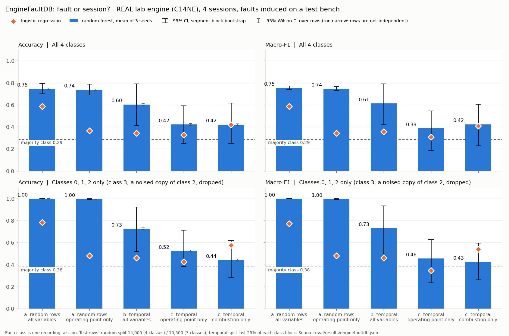

# EngineFaultDB: what it can and cannot show

**Data:** REAL lab engine (C14NE), 4 sessions, faults induced on a test bench. An Opel C14NE 1.4 L 4-cylinder petrol engine; 55,999 rows of 14 variables (MAP, TPS, Force, Power, RPM, two fuel-consumption columns, Speed, CO, HC, CO2, O2, Lambda, AFR). The source is [Leo-Thomas/EngineFaultDB](https://github.com/Leo-Thomas/EngineFaultDB), described in Vergara, Ramos, Rivera-Campoverde and Rivas-Echeverría, *EngineFaultDB: A Novel Dataset for Automotive Engine Fault Classification and Baseline Results*, IEEE Access 11 (2023) 126155–126171, doi:[10.1109/ACCESS.2023.3331316](https://doi.org/10.1109/ACCESS.2023.3331316). The data is **GPL-3.0**. It is cloned into `data/raw/enginefaultdb/` (git-ignored) and never committed.

**Not a 720 result column.** These are tabular exhaust and bench readings, not audio, so the numbers sit outside columns A/B/C.

## Headline

**This dataset cannot separate fault from session.** Each class is one contiguous block of rows, one recording session, so class and session are the same variable. Every split, random or temporal, tests on the session it trained on.

1. **On a random-row split, the operating point alone is enough.** RPM, TPS, MAP, Speed, Power and Force, with no exhaust chemistry, score **0.737** accuracy, against **0.745** for all 14 variables. With the duplicated class removed (point 3), operating point alone scores **0.997** and all variables **1.000**. A high random-split accuracy on this dataset measures session recognition.
2. **On the temporal split, everything collapses.** We trained on the first 70% of each block and tested on the last 25%. All variables fall to 0.60, operating point only to 0.42, combustion only to 0.42 (majority class 0.29). The honest 95% CIs span about ±0.18, because each class's test set holds only 2–4 operating-point segments. Operating-point-only does *not* score high here: the later segments of each session sit at operating points not seen in training. So the temporal test neither confirms nor rules out a session shortcut. The one-session-per-class design rules out the separation regardless.
3. **Class 3 ("low voltage") is a noised copy of class 2 ("lean").** Class 3 rows 0–13,999 match class 2 rows 1,000–14,999 one for one. MAP and TPS are bit-identical in all 14,000 rows. The other columns differ by small zero-mean noise (correlation 0.74–1.00). Classes 2 and 3 are a coin flip for every model and split: 2-vs-3 accuracy is 0.51–0.52 against a majority class of 0.52. This caps 4-class accuracy at about 0.74.



## What it can show

**Exhaust chemistry of rich and lean running on a real engine.** We compared each class with normal at matched RPM (250 rpm bins). The rich and lean classes move in the expected directions (table below). That is a sanity check on the labels, not evidence that a classifier detects these faults on a new session or engine.

## What it cannot show

- **That a model detects a fault rather than a session.** One session per class: see the headline.
- **Anything about low ignition voltage.** Class 3 has no signature of its own; against class 2 every combustion variable differs by ≤ 0.15 SD. HC goes *down* versus normal, the opposite of what misfiring would cause.
- **Generalisation across operating points.** The temporal test CIs are too wide: only 13 segments in the 4-class test set.
- **Label names, with certainty.** The README gives counts per label but no names, and the paper is paywalled. The mapping 0 normal / 1 rich / 2 lean / 3 low voltage is ours. The chemistry supports it for 1 and 2; nothing in the data supports or refutes it for 3.

## Inventory (`eval/enginefaultdb_inventory.json`)

| Class | Label (unconfirmed) | Rows | File rows | Segments | RPM mean ± sd | Lambda mean | λ > 1 share |
|---|---|---:|---|---:|---|---:|---:|
| 0 | normal | 16,000 | 0–15,999 | 10 | 2146 ± 890 | 0.957 | 22% |
| 1 | rich mixture | 10,998 | 16,000–26,997 | 6 | 2227 ± 886 | 0.930 | 26% |
| 2 | lean mixture | 15,000 | 26,998–41,997 | 11 | 2635 ± 927 | 0.982 | 40% |
| 3 | low voltage | 14,001 | 41,998–55,998 | 11 | 2567 ± 921 | 0.979 | 37% |

- A segment is a run of rows at one operating point. A new segment starts where RPM jumps by more than 500 rpm between consecutive rows. Row-to-row |ΔRPM| has a median of 41 and a p99 of 232; the 37 jumps above 500 reach up to 2852 rpm, and nearly all fall on a 1000-row grid.
- **Units as the README gives them.** MAP is stated in kPa but has a mean of about 1.8, so it is probably a sensor voltage. Treat MAP and TPS as raw signals.
- Every class also differs in operating point: mean RPM 2146 / 2227 / 2635 / 2567, and mean speed 46 / 48 / 57 / 55 km/h.

## Split (`data/splits/enginefaultdb_split.json`, committed before any training)

- **Temporal:** within each class block, the first 70% of rows train, the next 5% are dropped as a gap, and the last 25% test. Rows are never shuffled.
- **Random:** 25% of rows per class, drawn with seed 720 and stored as the seed plus a SHA-256 of the test rows. The loader recomputes the draw and refuses to run if it doesn't match.

## Results (`eval/results/enginefaultdb.json`)

The random forest score is the mean of seeds 0–2. The CI is a 95% block bootstrap that resamples whole operating-point segments. The Wilson CI over rows is about ±0.008, but rows are not independent, so it is reported in the JSON and not used. Logistic regression is standardised and multinomial.

| Run | Split | Variables | RF acc [95% CI] | RF macro-F1 [95% CI] | LR acc |
|---|---|---|---|---|---:|
| a | random | all 14 | 0.745 [0.701, 0.795] | 0.753 [0.738, 0.773] | 0.587 |
| a_op | random | operating point | 0.737 [0.690, 0.788] | 0.745 [0.730, 0.766] | 0.365 |
| a_comb | random | combustion | 0.746 [0.700, 0.795] | 0.755 [0.740, 0.774] | 0.533 |
| b | temporal | all 14 | 0.604 [0.412, 0.791] | 0.612 [0.420, 0.791] | 0.344 |
| c_op | temporal | operating point | 0.422 [0.248, 0.591] | 0.385 [0.184, 0.546] | 0.326 |
| c_comb | temporal | combustion | 0.420 [0.246, 0.616] | 0.423 [0.228, 0.605] | 0.421 |

The test sets have 14,000 rows (random) and 13,999 rows (temporal), with majority class 0.286. Operating point = RPM, TPS, MAP, Speed, Power, Force. Combustion = Lambda, AFR, O2, CO, HC, CO2.

**Without class 3** (classes 0, 1, 2; majority class 0.381): a 1.000, a_op 0.997, b 0.727 [0.520, 0.923], c_op 0.524 [0.383, 0.713], c_comb 0.441 [0.280, 0.619]. Logistic regression on c_comb scores 0.576.

Confusion matrices for every run are in the JSON. On the random split the forest is perfect on classes 0 and 1 and splits 2/3 about 50/50.

## Physics sanity check (vs normal, RPM-matched)

Each value is the RPM-matched difference divided by the normal class's SD. Below 0.1 SD counts as negligible.

| Class | Lambda | AFR | CO | HC | O2 |
|---|---|---|---|---|---|
| 1 rich (expect λ↓ AFR↓ CO↑ HC↑ O2↓) | −0.59 ✔ | −0.59 ✔ | +0.88 ✔ | +1.29 ✔ | +0.05 negligible |
| 2 lean (expect λ↑ AFR↑ CO↓ O2↑) | +0.57 ✔ | +0.57 ✔ | −0.74 ✔ | −0.81 (no expectation) | +0.19 ✔ (raw mean is lower; sign flips once RPM is matched) |
| 3 low voltage (expect HC↑ if misfiring) | +0.58 | +0.58 | −0.75 | −0.82 ✘ inconsistent | +0.18 |

Rich and lean are consistent with combustion chemistry. Low voltage is not; it reproduces lean exactly, as the copy would predict. Every class, normal included, averages λ < 1.

## Reproduce

```bash
git clone https://github.com/Leo-Thomas/EngineFaultDB data/raw/enginefaultdb
python data/enginefaultdb.py          # inventory
python data/enginefaultdb_split.py    # split (already committed; rerunning rewrites created_at)
python -m eval.enginefaultdb          # results + figure, about 1.5 min on CPU
python -m pytest data/tests/test_enginefaultdb.py -q
```
